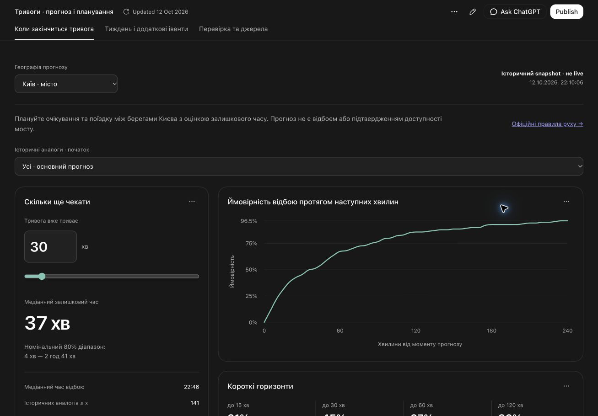
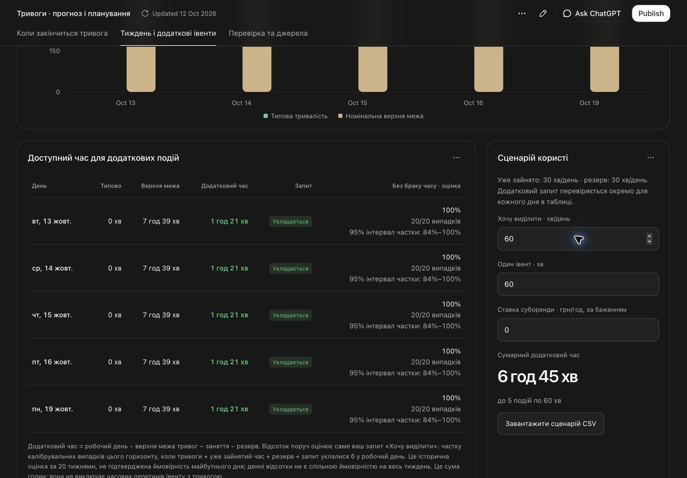

# Air Alerts Analysis

Два прогнози на основі історії повітряних тривог, Python-аналіз та інтерактивний React-дашборд:

1. **Залишковий час:** скільки ще триватиме тривога, якщо вона вже активна x хвилин; медіана, номінальний 80% діапазон і ймовірності відбою за 15/30/60/120 хвилин.
2. **Наступні сім днів:** хвилини під тривогою в робочому вікні, номінальні верхні межі та умовний часовий резерв для додаткових подій.

[Відкрити дашборд](https://tymof1j.github.io/air-alerts-analysis/) · [Методологія](docs/PLAN.md) · [Фінальні результати](reports/holdout.json) · [Зафіксований вибір моделей](reports/selection.json)

## Скриншоти дашборду

**Коли закінчиться тривога:** залишковий час та ймовірності відбою.



**Overbooking укриття:** уже зайнятий час, додатковий запит, кількість івентів і історична оцінка достатності часового бюджету. Ілюстрація: 30 хв уже зайнято, запит 60 хв на день. Показані відсотки є дослідницькими історичними частками, а не гарантією доступності укриття.



## Практична користь

Оцінка залишкового часу допомагає жителям Києва планувати очікування, повернення з роботи та пересування між берегами. Прогноз не є сигналом відбою і не встановлює доступність маршруту. [Актуальні офіційні правила руху](https://dti.kyivcity.gov.ua/news/u-stolytsi-diiut-tymchasovi-obmezhennia-dorozhnoho-rukhu-pid-chas-povitrianoi-tryvohy) залежать від конкретного мосту й обмежень.

Тижневий планер оцінює потенціал уже наявного приміщення: додаткові офлайн-івенти KSE, знайомства, нетворкінг, розвиток спільноти та впізнаваність університету. Для офісів і бізнес-центрів це можливі години суборенди. Основні одиниці — хвилини, години та події. Не припускаємо витрат на придбання приміщення; введена орендна ставка дає тільки умовний валовий дохід, не доведений прибуток.

## Чесний результат, включно з провалом моделі

Моделі та параметри зафіксовано до відкриття holdout 28.09–11.10.2026. Для Києва умовна оцінка за останні 90 днів виграла development-порівняння; її holdout Brier = **0.197**, MAE залишкового часу = **39.3 хв**, фактичне покриття номінального 80% діапазону = **71.7%**, на 111 епізодах.

Для робочого дня 09–19 обраний gradient boosting мав holdout MAE **217.5 хв**; наперед визначений recent30 baseline — **121.7 хв**. Номінальна 95% денна межа покрила **9/14 днів**, одночасна тижнева — **1/2 тижнів**. Це провал перенесення на новіший режим, а не підтверджена 95% гарантія. Обрану модель не підміняли кращим на holdout методом після перегляду результатів.

За замовчуванням увімкнений дослідницький сценарій, який показує `max(0, робочий час − верхня межа тривог − заняття − резерв)`. Біля кожного дня показана емпірична частка з 20 калібрувальних випадків відповідного горизонту, коли задане бронювання вмістилося б у часовий бюджет після перенесення історичної помилки на поточний прогноз. Це дослідницька оцінка, не калібрована гарантія майбутнього дня чи всього тижня. Ця арифметика не гарантує відсутність часових перетинів, доступність укриття або місткість для людей. Значення 0 у типовому прогнозі також не означає відсутність ризику: модель недооцінює новий режим.

## Дашборд

На обох прогнозних сторінках є інструкція з трьох кроків з обов’язковими та опційними параметрами.

Окрема вкладка **«Пошук закономірностей»** містить частоту й тривалість за годиною початку, гістограму, топ завантажених днів, теплову карту день × година, зрізи за днями тижня, календарними місяцями, сезонами та днем/ніччю, а також рейтинг середньої тривалості за областями. Періоди: 30, 90, 365 днів або від 2023 року. Частоти нормовані на календарну експозицію; описові графіки не використовуються для повторного вибору моделі після holdout.

- Минулі хвилини, фільтр аналогів день/ніч та окремий блок історичної перевірки з прогнозом та фактичною тривалістю поруч.
- Прогноз по днях, чотири робочі вікна, денна/тижнева номінальна 95% межа.
- Умовні заняття, резерв, довжина події та орендна ставка; CSV-експорт.
- Київ місто + 23 області, кожна зі своїм вибором моделей; обласні джерела мають окремі обмеження.
- Порівняння з усіма baselines, приклад raw-записів і джерела графіків.

Це **snapshot станом на 12.10.2026**, не live-сервіс. У міській історії немає окремих районів Києва. Райони Київської області не видаємо за райони столиці. Yellow/red атрибути збережені, але не використовуються як прогнозні входи без підтвердження їх часової доступності.

## Дані: два основні джерела

1. **Київ, офіційні дані:** [муніципальний експорт інтервалів](https://data.kyivcity.gov.ua/dataset/bb0f27d3-00e2-414a-9d6e-a8b6633f8a2a/resource/5e4fb8a8-f0c8-4a12-885f-192d1f0dba75) з level/cause; [історія Kyiv Digital](https://kyiv.digital/open-api/air-alert/history) із start/all-clear та масивами причин. Це взаємодоповнювальні представлення тих самих подій, не дві незалежні вибірки. [API documentation](https://kyiv.digital/open-api/docs/air-alert.html).
2. **Області, волонтерська історія:** [eTryvoga через Vadimkin](https://github.com/Vadimkin/ukrainian-air-raid-sirens-dataset). Імітовані та непозитивні інтервали виключені; обласна експозиція може бути занижена. Постійні тривоги та Крим мають окремі прогалини; Луганськ не включений до моделей.

[Raw snapshots та checksums](data/raw/snapshots/2026-10-12T191154Z/) · [Аудит якості](reports/data_quality.json) · [Детальний вибір джерел](data/kyiv_data_choice.md). Сирі файли залишаються незмінними. Часи конвертуються в Europe/Kyiv, з явною обробкою DST; записи без підтвердженого відбою не отримують вигаданої тривалості.

## Відкрити локально за одну команду

```bash
python3 -m http.server 4178 --bind 127.0.0.1 --directory site
```

Відкрити <http://127.0.0.1:4178/>. Браузерна версія не потребує Python-сервера моделей, npm, токенів чи зовнішніх API.

## Відтворити Python-аналіз

```bash
python3.11 -m venv .venv
.venv/bin/python -m pip install -r requirements.txt
.venv/bin/python -m pytest -q
PYTHONPATH=src .venv/bin/python -m air_alerts.data
PYTHONPATH=src .venv/bin/python -m air_alerts.pipeline select
# Спершу зафіксувати reports/selection.json у Git; потім відкрити фінальний тест:
PYTHONPATH=src .venv/bin/python -m air_alerts.pipeline evaluate
.venv/bin/python scripts/finalize_dashboard.py
```

Selection і evaluate розділені навмисно. Fingerprints фіксують дані, model code, pipeline і протокол. Повторний запуск — відтворення вже відкритого тесту, не новий незалежний експеримент.

## Хостинг

**GitHub Pages:** workflow `.github/workflows/pages.yml` публікує перевірений каталог `site/`. Джерело Pages — GitHub Actions.

**Vercel:** імпортувати цей GitHub repo, root directory — корінь репозиторію. `vercel.json` задає static framework, порожній build/install command і output `site`. Уже зібраний дашборд включено до репозиторію, тому навчання при deploy не запускається.

React-source розташований у `dashboard/src/content/dashboard/`, дані — `dashboard/src/data.json`. Локальна перевірена збірка створена Data app builder; `scripts/package_site.py` копіює її без зміни в `site/`. Для перебудови без цього builder можна виконати `npm ci && npm run build` у `dashboard/` з Node 22.12+; після збірки запустити `python3 scripts/package_site.py`. Source-build шлях включений для відтворення, поточна публікаційна збірка перевірена локально.

## Перевірки і наступне покращення

9 Python-тестів перевіряють interval union, DST, conditioning, leakage, доступність міток і conformal rank. Додатково звірено 72 браузерні/Python прогнози. Перевірено вкладки, сценарні контролі, зміну географії, реальні графіки й мобільну ширину.

Потрібне наступне дослідження: модель з адаптацією до зміни режиму і новий, ще не використаний тестовий період. Наявний holdout не можна повторно назвати незалежним після підбору покращень. Даних для окремої надійної red-моделі замало.

Для подання потрібен також повний експорт AI-розмови з T3. Його слід експортувати з інтерфейсу; репозиторій не видає короткий звіт за повний лог.
